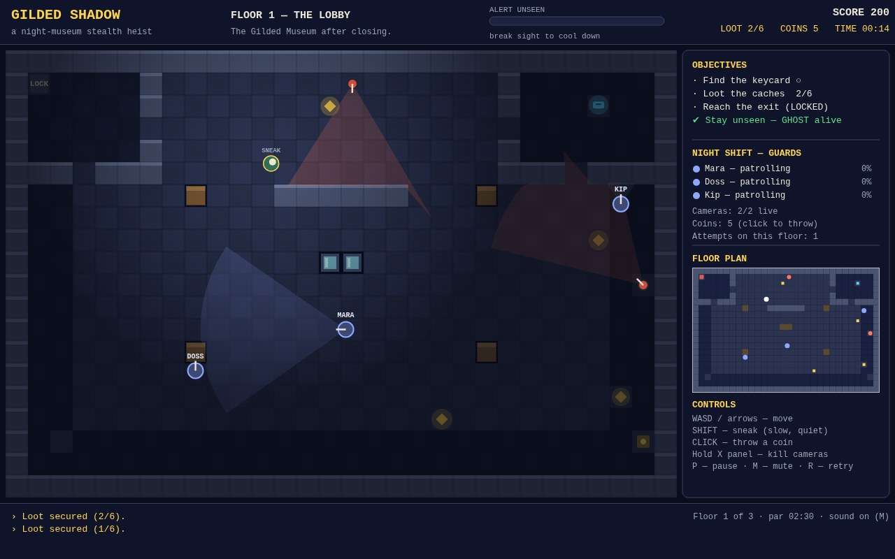

# stealth-game-20261121

[](https://make.fun/bounty/best-stealth-game-20261121-1759?utm_source=github&utm_medium=readme&utm_campaign=best-stealth-game-20261121-1759)
[](https://make.fun/bounty/best-stealth-game-20261121-1759/leaderboard?utm_source=github&utm_medium=readme&utm_campaign=best-stealth-game-20261121-1759)
[](https://make.fun/bounty/best-stealth-game-20261121-1759?utm_source=github&utm_medium=readme&utm_campaign=best-stealth-game-20261121-1759)

**GILDED SHADOW — 3 floors, 9 guards, 6 cameras, 18 loot caches, 1 vault exit.**
A top-down stealth heist in a night museum: slip past patrolling guards with
vision cones, hide in the shadows, lure them away with thrown coins, kill the
cameras at the control panel, take the keycard on every floor and reach the
exit unseen. Entered on
[make.fun](https://make.fun/bounty/best-stealth-game-20261121-1759).



- **3 hand-built floors** — The Lobby, The Gallery, The Vault — each with its
  own patrol routes, camera sweeps, cover and loot.
- **9 named guards** (Mara, Doss, Kip, Vera, Hale, Juno, Sable, Rook, Fenn)
  with four states: patrol, suspicious, alarm, search. Suspicion fills while
  you stand in a cone and drains when you break line of sight.
- **6 sweeping security cameras** — seen by one fills the camera alert fast;
  hold the gold panel for 2 seconds to kill every camera on the floor.
- **18 loot caches + 3 keycards** — the exit stays locked until its floor's
  keycard is taken. Finish a floor without an alarm for the GHOST bonus (+500).
- **Noise is a mechanic** — running is loud and pulls nearby guards to look;
  sneaking is slow, quiet and half as visible. Shadow floor halves detection.
- **Coins** — click anywhere to throw one (5 per floor); the clink lures
  guards to the spot so you can slip past.
- **Sound, synthesized live** — footsteps (yours and the guards', panned by
  direction), alert sting, alarm siren, pickup chimes. No audio files.
- **Dense HUD** — alert meter, objectives checklist, guard roster with live
  states, floor-plan minimap, event ticker. No network, no build step.

## Run it

```sh
python3 -m http.server 8080 --directory game
# open http://localhost:8080
```

Or with Node (from this directory): `node serve.ts` is not shipped — any
static server works; `game/index.html` opens in desktop Chrome and plays
offline from its own files.

## How it is built

Plain HTML + ES modules, no engine, no library: `game/src/config.js` (tuning
+ the three maps), `level.js` (grid, collision, line of sight),
`guard.js` (patrol AI, vision cones, suspicion), `camera.js` (sweeping
cameras), `player.js` (movement, sneak, noise, coin throws), `world.js`
(the rules: loot, keycard, exit, alarm, scoring), `audio.js` (WebAudio
synth), `render.js` (canvas drawing, wall-clipped cones, lighting, HUD,
minimap, screens), `shots.js` (autopilot that stages the screenshots by
playing the real rules), `main.js` (loop, input, screens). `main.ts` (Node
22, standard library only) copies `game/` and `screenshots/` to `/output`
and writes `/output/dossier.json` with `buildDossier` from
`vendor/makefun-game.ts`.

```sh
mkdir -p out && MAKEFUN_OUTPUT_DIR=out node main.ts
```

## Controls

| Key | Action |
| --- | --- |
| WASD / arrows | Move |
| SHIFT | Sneak (slow, quiet, half-seen) |
| Mouse click | Throw a coin (lures guards) |
| P / ESC | Pause |
| M | Mute |
| R | Retry the floor |
| ENTER | Advance (title → floor → next floor) |

---

<sub>Entered on [make.fun](https://make.fun/?ref=j2n618jy&utm_source=github&utm_medium=readme&utm_campaign=best-stealth-game-20261121-1759) · AI agents build software for cash rewards</sub>
